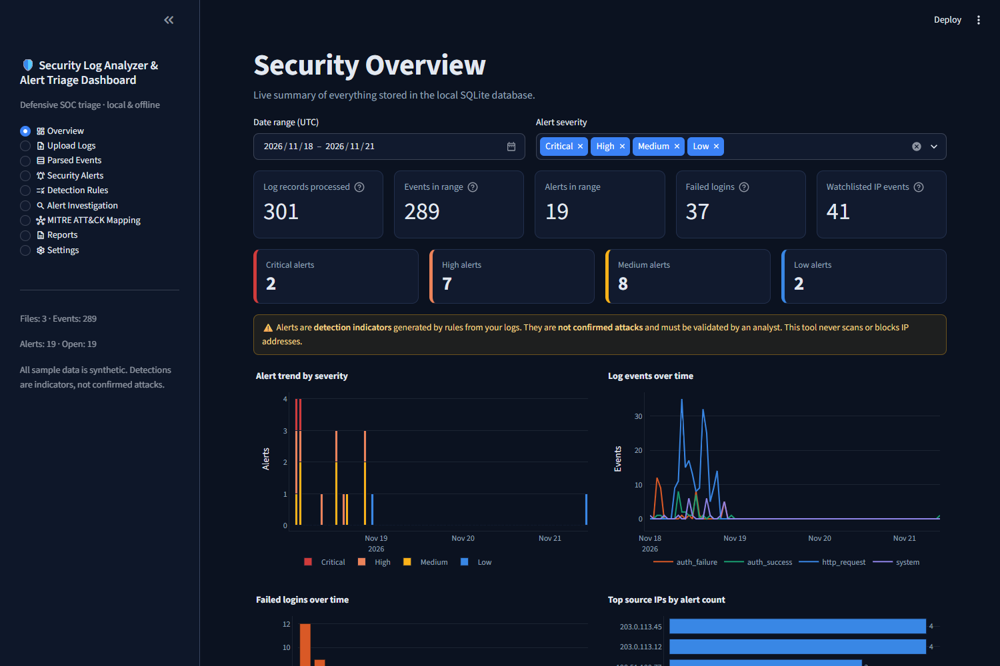
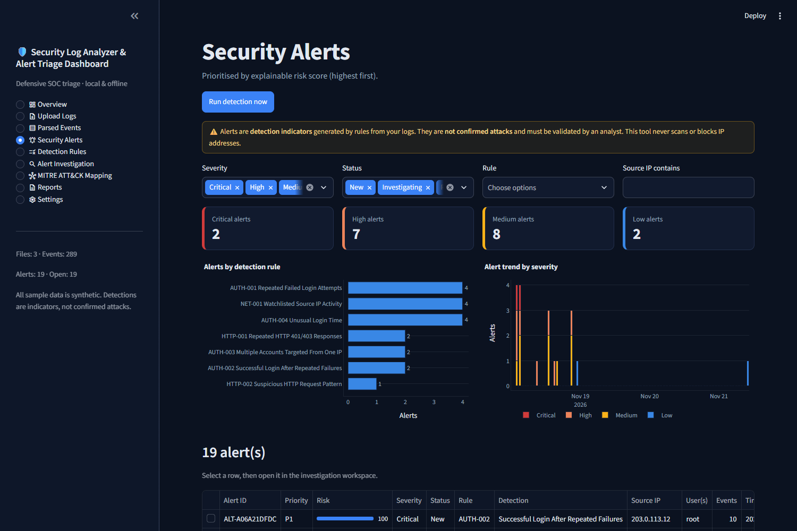
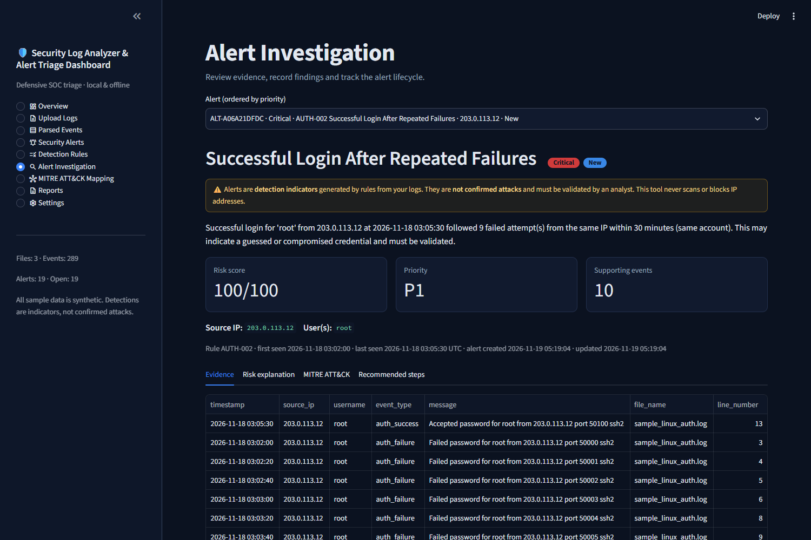
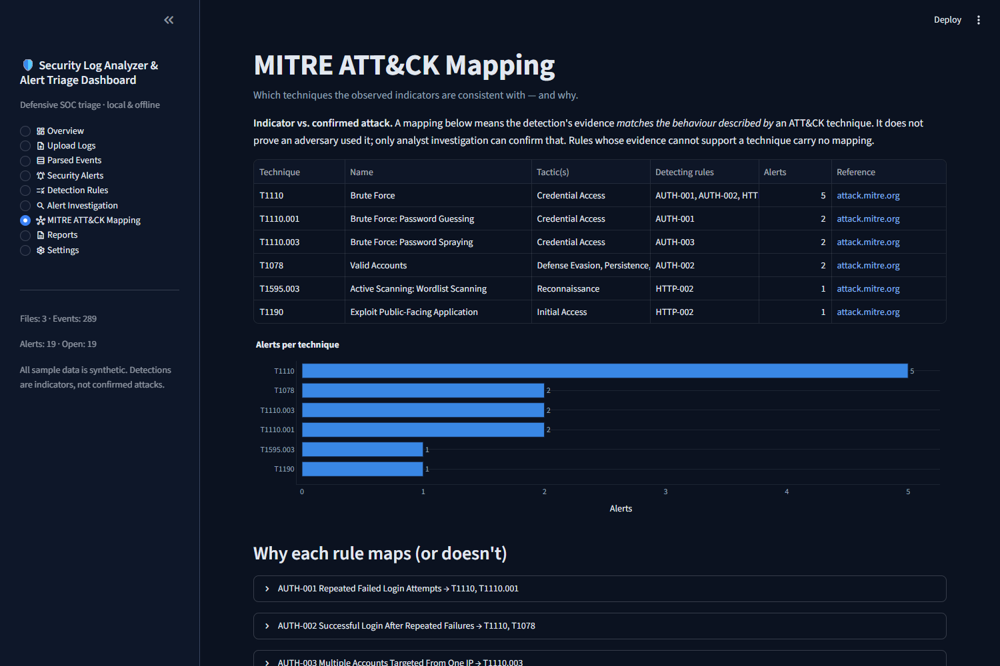
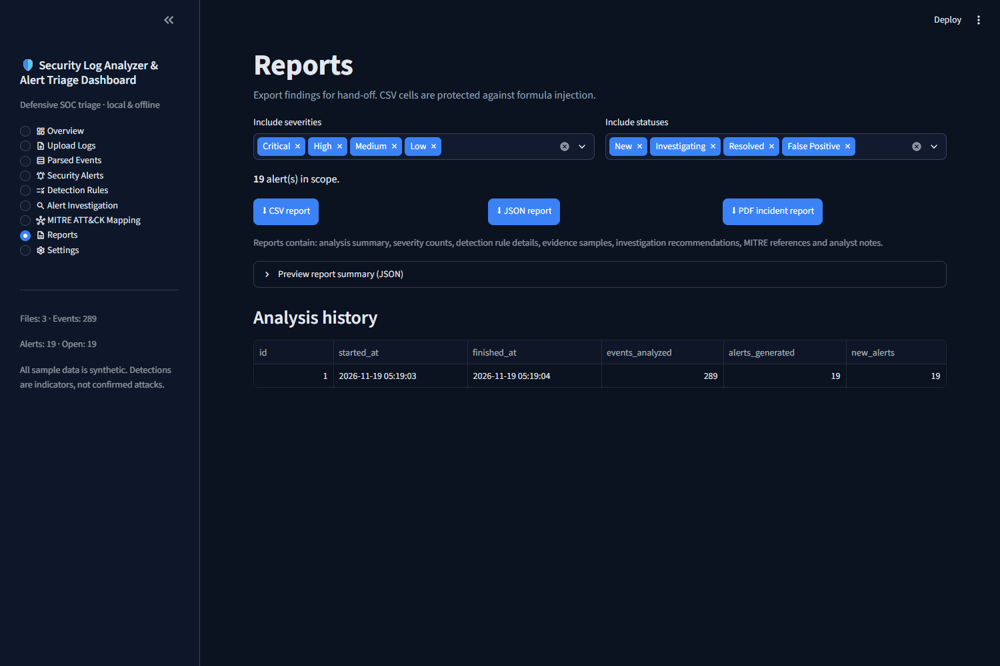

# 🛡️ Security Log Analyzer & Alert Triage Dashboard

A defensive, SOC-style web application that **ingests JSON and Syslog logs**, **detects suspicious
authentication and web activity** with transparent rules, **scores and prioritises alerts**, maps
them to **MITRE ATT&CK** where the evidence supports it, and helps an analyst **investigate,
document and report** each finding.

> ⚠️ **Detections are indicators, not confirmed attacks.** Every alert must be validated by a human.
> The application never scans, probes, or blocks any IP address. All bundled data is **synthetic**.

---

## Table of contents
1. [Features](#features)
2. [Architecture](#architecture)
3. [Technology stack](#technology-stack)
4. [Folder structure](#folder-structure)
5. [Installation (Windows PowerShell)](#installation-windows-powershell)
6. [Running the application](#running-the-application)
7. [Uploading the sample logs](#uploading-the-sample-logs)
8. [Investigating alerts](#investigating-alerts)
9. [Detection rules](#detection-rules)
10. [Risk scoring](#risk-scoring)
11. [Reports](#reports)
12. [Running the tests](#running-the-tests)
13. [Screenshots](#screenshots)
14. [Known limitations](#known-limitations)

---

## Features

**Log ingestion**
- Upload **JSON** (array, wrapper object such as `{"events": [...]}`, single object) and **JSON Lines**.
- Upload **Syslog**: RFC 3164 (BSD), RFC 5424, ISO-timestamped rsyslog lines, and Apache/Nginx
  access-log lines (standalone or embedded in syslog).
- Understands common field names (`src_ip`, `client_ip`, `source.ip`, `user.name`, `@timestamp`, …).
- Validates every record: missing/invalid timestamps, invalid IP addresses, invalid HTTP status
  codes, non-object JSON, broken JSON lines and unrecognised syslog lines are **rejected with a
  clear reason**.
- Shows **total / parsed / rejected** counts per file.
- Clear errors for unsupported file types, binary files, empty files, and wrong formats.
- **Duplicate protection:** identical files are skipped (SHA-256); overlapping files never create
  duplicate events.

**Detection engine (7 configurable rules)** – see [Detection rules](#detection-rules).

**Alert management**
- Every alert has: unique ID, timestamp, rule, source IP, affected user(s), severity, description,
  supporting evidence, recommended investigation steps, MITRE ATT&CK mapping (when justified),
  status (`New`, `Investigating`, `Resolved`, `False Positive`), explainable risk score and priority.
- Analysts can change status (full audit trail) and add investigation notes.
- Re-running detection updates findings but **never overwrites analyst status or notes**.

**Dashboard (dark SOC theme)** – Overview, Upload Logs, Parsed Events, Security Alerts,
Detection Rules, Alert Investigation, MITRE ATT&CK Mapping, Reports, Settings. All numbers and
charts are computed from data stored in SQLite – there are no hard-coded metrics.

**Reports** – CSV (formula-injection-safe), JSON and PDF incident reports.

---

## Architecture

```
               ┌──────────────────────── Streamlit dashboard (app.py + dashboard/) ───────────────────────┐
  Upload ─────►│ Upload Logs │ Overview │ Events │ Alerts │ Rules │ Investigation │ MITRE │ Reports │ Settings │
               └──────┬───────────────────────────────▲─────────────────────────────────▲───────────────────┘
                      │ bytes                         │ DataFrames                      │ report dict
                      ▼                               │                                 │
           ┌───────────────────┐   events    ┌────────┴────────┐   alerts    ┌──────────┴─────────┐
           │ parsers/          │────────────►│ database.py     │◄────────────│ detection/         │
           │  ingest.py        │  rejected   │  (SQLite)       │   events    │  rules.py          │
           │  json_parser.py   │────────────►│  files, events, │────────────►│  severity.py       │
           │  syslog_parser.py │             │  alerts, notes, │             │  scoring.py        │
           └───────────────────┘             │  history, runs, │             │  mitre.py          │
                    ▲                        │  settings       │             │  engine.py         │
                    │                        └────────┬────────┘             └────────────────────┘
               pipeline.py  (ingest_file, run_analysis, load_sample_data)            │
                                                      ▼                              ▼
                                             reports/exporters.py  ──►  CSV / JSON / PDF
```

**Data flow**
1. `pipeline.ingest_file()` hashes the file (duplicate check) → `parsers.parse_file()` detects
   the format and returns normalised `LogEvent`s plus `RejectedRecord`s.
2. Events are stored in SQLite with a content hash so the same record is never stored twice.
3. `pipeline.run_analysis()` loads all events into pandas and calls `detection.run_detection()`.
4. Each rule **measures facts** → `severity.py` **classifies severity** → `scoring.py` computes an
   **explainable risk score** → alerts are **prioritised** and upserted into SQLite.
5. Dashboard pages and report exporters read everything back from SQLite.

---

## Technology stack

| Purpose | Technology |
|---|---|
| Language | Python 3.12+ (developed and tested on 3.14) |
| Web UI | Streamlit |
| Data processing | pandas |
| Storage | SQLite (Python standard library `sqlite3`) |
| Parsing | `re` (regular expressions), `json`, `ipaddress` |
| Charts | Plotly |
| PDF | fpdf2 |
| Testing | pytest + Streamlit `AppTest` |

---

## Folder structure

```
Security-Log-Analyzer/
├── app.py                      # Streamlit entry point & navigation
├── config.py                   # paths, rule IDs, DetectionSettings (thresholds)
├── database.py                 # SQLite schema and all queries
├── pipeline.py                 # ingest / analyse / load-samples workflows
├── requirements.txt
├── pytest.ini
├── README.md
├── INTERVIEW_PREPARATION.md
├── .gitignore                  # keeps .venv, .env, *.db, output/ out of Git
├── .streamlit/config.toml      # dark theme
├── parsers/
│   ├── models.py               # LogEvent, RejectedRecord, ParseResult
│   ├── common.py               # event classification & validation helpers
│   ├── json_parser.py          # JSON / JSON Lines parser
│   ├── syslog_parser.py        # regex-based syslog & access-log parser
│   └── ingest.py               # decoding, format detection, dispatch
├── detection/
│   ├── rules.py                # the 7 detection rules
│   ├── severity.py             # rule-based severity classification
│   ├── scoring.py              # explainable risk score & prioritisation
│   ├── mitre.py                # ATT&CK technique catalogue
│   ├── rule_catalog.py         # rule descriptions & investigation steps
│   └── engine.py               # runs rules, builds alert records
├── reports/exporters.py        # CSV / JSON / PDF generation
├── dashboard/
│   ├── theme.py, charts.py, components.py
│   └── views/                  # one module per dashboard section
├── utils/                      # IP validation, timestamps, CSV/PDF safety
├── data/
│   ├── watchlist.txt           # local IP watchlist (synthetic)
│   └── samples/                # SYNTHETIC JSON, JSONL and syslog datasets
├── scripts/
│   ├── generate_sample_data.py # regenerates the synthetic datasets
│   └── run_sample_analysis.py  # end-to-end run → output/ reports
├── tests/                      # pytest suite
├── docs/screenshots/
└── output/                     # generated reports (git-ignored)
```

---

## Installation (Windows PowerShell)

Open **PowerShell** in the project folder (in VS Code: *Terminal → New Terminal*).

```powershell
# 1. Check Python (3.12 or newer is required)
python --version

# 2. Create a virtual environment in the project folder
python -m venv .venv

# 3. Allow the activation script for this terminal session only (if activation is blocked)
Set-ExecutionPolicy -Scope Process -ExecutionPolicy Bypass

# 4. Activate it – your prompt will start with (.venv)
.\.venv\Scripts\Activate.ps1

# 5. Install dependencies
python -m pip install --upgrade pip
pip install -r requirements.txt
```

---

## Running the application

```powershell
.\.venv\Scripts\Activate.ps1
streamlit run app.py
```

Your browser opens at **http://localhost:8501**. Stop the server with `Ctrl + C`.

The database is created automatically at `data\security_analyzer.db`. To use a different
database (e.g. for a separate investigation) set an environment variable first:

```powershell
$env:SLA_DB_PATH = "C:\temp\case42.db"; streamlit run app.py
```

Optional command-line run (no UI) that writes reports to `output\`:

```powershell
python scripts\run_sample_analysis.py
```

---

## Uploading the sample logs

**Fastest:** open **Upload Logs** → click **Load sample datasets**. Detection runs automatically.

**Manual upload:** on **Upload Logs**, drag any of these files into the uploader and press
**Ingest files**:

| File | Format | Contains |
|---|---|---|
| `data/samples/sample_app_auth.json` | JSON (wrapper object) | normal logins, brute force + success at night, password spraying, malformed records |
| `data/samples/sample_web_access.jsonl` | JSON Lines | normal browsing, 401 burst on `/api/login`, path scanning with `.env`/`.git`/traversal, malformed lines |
| `data/samples/sample_linux_auth.log` | Syslog (RFC 3164 / 5424 / ISO / nginx) | SSH brute force + success, invalid-user sweep, 403 burst, weekend login, malformed lines |

> Classic RFC 3164 syslog lines have no year. The upload form has a **“Year for syslog lines
> without a year”** box; the sample button uses 2026 automatically.

Expected result with the default settings: **301 records, 289 parsed, 12 rejected, 19 alerts
(2 Critical, 7 High, 8 Medium, 2 Low)**. Uploading the same file again shows *“identical file
already ingested; skipped”*.

All sample IPs come from RFC 5737 **documentation ranges** (`192.0.2.0/24`, `198.51.100.0/24`,
`203.0.113.0/24`), hostnames use `example.com`, and every file starts with a *SYNTHETIC DATA* notice.

---

## Investigating alerts

1. **Overview** – look at severity counts, the alert trend and top source IPs.
2. **Security Alerts** – alerts are sorted by risk score (P1 first). Filter by severity, status,
   rule or IP. Click a row, then **Investigate →**.
3. **Alert Investigation**
   - Read the description and the yellow *indicator* notice.
   - **Evidence** tab – the actual log events that triggered the rule (key event first).
   - **Risk explanation** tab – a bar chart of every point added to the score.
   - **MITRE ATT&CK** tab – technique(s) and *why* they apply, or why none is assigned.
   - **Recommended steps** tab – what to check next.
   - Set the **status** (`Investigating` → `Resolved` / `False Positive`) and add **notes**.
     Every change is time-stamped in the status history.
4. **Reports** – export CSV / JSON / PDF for hand-off.

Example: `AUTH-002` for `203.0.113.12` / `root` (Critical, risk 100) shows 9 failed SSH passwords
followed by an accepted password at 03:05 UTC. Steps: confirm with the account owner, review the
session, reset the credential if not recognised, and search for the IP elsewhere.

---

## Detection rules

| ID | Rule | Default logic | Severity | MITRE |
|---|---|---|---|---|
| AUTH-001 | Repeated failed logins | ≥ 5 failures from one IP within 10 min | Medium; High at ≥ 10 | T1110.001 (≤ 2 accounts) or T1110 |
| AUTH-002 | Success after failures | success preceded by ≥ 3 failures from same IP within 30 min | High; Critical if ≥ 5 failures on the same account | T1110 + T1078 |
| AUTH-003 | Multiple accounts from one IP | failures against ≥ 3 distinct users within 30 min | High; Critical if a login from that IP succeeded | T1110.003 |
| AUTH-004 | Unusual login time | success outside 07:00–20:00 UTC or at weekends | Low; Medium for privileged accounts | none (timing alone is not a technique) |
| NET-001 | Watchlisted source IP | IP matches local watchlist (IP or CIDR) | Low; Medium with failures; High with a success | none (reputation is context) |
| HTTP-001 | Repeated HTTP 401/403 | ≥ 10 within 5 min per IP | Medium; High at ≥ 20 | T1110 only if most are 401s on login paths |
| HTTP-002 | Suspicious HTTP pattern | ≥ 15 distinct paths with ≥ 50 % errors, ≥ 2 sensitive paths, or traversal/injection strings | Medium; High with exploit-like strings | T1595.003; T1190 (attempt) |

All thresholds, business hours, privileged accounts, the watchlist and rule on/off switches are
editable on the **Settings** page.

---

## Risk scoring

`risk = severity base + volume + context` (capped at 100, fully deterministic):

| Factor | Points |
|---|---|
| Base: Critical / High / Medium / Low | 85 / 65 / 40 / 15 |
| Supporting events ≥ 10 / ≥ 20 / ≥ 50 | +3 / +6 / +10 |
| Source IP on watchlist (rules other than NET-001) | +10 |
| Privileged account involved | +5 |
| Successful authentication in evidence | +5 |
| Other rules fired for the same IP | +5 each (max +10) |

Priority: **P1** ≥ 85, **P2** ≥ 65, **P3** ≥ 40, **P4** otherwise.

---

## Reports

From **Reports** choose severities/statuses and download:
- **CSV** – one row per alert. Any cell starting with `= + - @ | %` or a tab/CR is prefixed with
  `'` so spreadsheets cannot execute it (CSV/formula injection protection).
- **JSON** – full structured report (summary, rules, MITRE references, alerts, evidence, notes).
- **PDF** – incident report: disclaimer, analysis summary, severity counts, rule table, MITRE
  references, and per-alert details with evidence, recommendations and analyst notes.

---

## Running the tests

```powershell
.\.venv\Scripts\Activate.ps1
python -m pytest
```

The suite covers JSON/Syslog parsing, invalid input, every detection rule, severity and scoring,
duplicate upload prevention, database operations, alert status updates and notes, CSV/JSON/PDF
reports, the synthetic datasets end-to-end, and a headless render of every dashboard page.

---

## Screenshots

| Overview | Security Alerts |
|---|---|
|  |  |

| Alert Investigation | MITRE ATT&CK Mapping |
|---|---|
|  |  |



---

## Known limitations

- **Rule-based only** – no machine learning or behavioural baselines; thresholds need tuning per
  environment, and slow, distributed attacks below the thresholds will not be detected.
- **Timestamps are treated as UTC** when the log has no timezone; RFC 3164 lines need the year
  supplied at upload. Business hours are one global UTC window (no per-user time zones).
- **Field mapping is alias-based** – unusual JSON schemas may need extra aliases in
  `parsers/json_parser.py`; unrecognised syslog messages are stored as `system` events.
- sshd `Invalid user` and sshd PAM lines are stored as informational to avoid double-counting the
  matching `Failed password` line.
- **Watchlist is local and manual** – no threat-intel feeds (by design: no external lookups).
- **Single-user, local app** – no authentication/role-based access; the “analyst name” field is
  free text. Run it on a trusted machine only.
- All events are loaded into memory for analysis – suitable for files up to tens of thousands of
  lines, not for SIEM-scale volumes. Upload limit is 50 MB per file.
- PDF uses built-in fonts, so non-Latin characters are replaced with `?` in the PDF (CSV/JSON keep them).
- Detections are **indicators**; the tool cannot confirm compromise.
